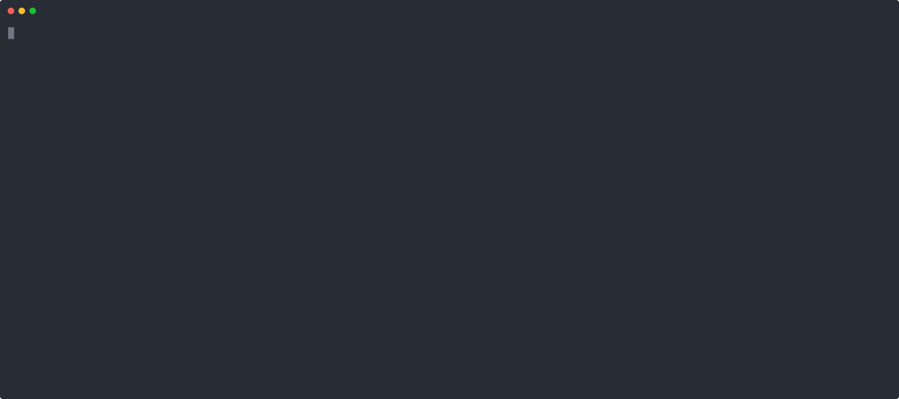

# chatgpt-prune

Bulk-delete ChatGPT chats from the terminal. Filter by date, project, title, pinned or archived. One Python file.



I had over a thousand old chats to clean up. The Chrome extensions I tried were still too manual (one checkbox per chat), buggy, or paid. I could not find a script for this on GitHub. This script selects chats with filters, shows the list, and deletes them after one confirmation.

**Delete is permanent.** You cannot restore a deleted chat. Run with `--dry-run` first.

## Quick start

1. Install [uv](https://docs.astral.sh/uv/). It installs Python and the dependencies on the first run.
   ```sh
   brew install uv   # or: curl -LsSf https://astral.sh/uv/install.sh | sh
   ```
2. Open chatgpt.com and log in. In the DevTools console (Chrome: `Cmd+Option+J` on macOS, `Ctrl+Shift+J` on Windows and Linux), run this. It copies your access token. The console prints `undefined`. That is normal.
   ```js
   copy((await (await fetch('/api/auth/session')).json()).accessToken)
   ```
3. List what would be deleted. Paste the token when the script asks for it.
   ```sh
   uv run https://raw.githubusercontent.com/wingsofovnia/chatgpt-prune/refs/heads/main/chatgpt_prune.py --exclude-pinned --dry-run
   ```

The token gives full access to your account. Do not share it. It lasts about 10 days. If you get HTTP 401, get a new one. To skip the prompt, set `CHATGPT_ACCESS_TOKEN`.

## Usage

The examples use a short name for the command:

```sh
alias chatgpt-prune='uv run https://raw.githubusercontent.com/wingsofovnia/chatgpt-prune/refs/heads/main/chatgpt_prune.py'

# Delete everything except pinned chats and one project. List first, delete nothing.
chatgpt-prune --exclude-pinned --exclude-project-name="Keep" --dry-run

# Delete chats last updated before July. The script lists them and asks you to type a confirmation word.
chatgpt-prune --updated-before=2026-07-01 --exclude-pinned

# Delete chats of one project. Ask for each chat.
chatgpt-prune --project-name="Work" --interactive
```

Run `--help` for all flags.

The script works in 3 stages:

1. **Select** what to delete: `--updated-before/after`, `--project-name`, `--title-contains`. With no select flag, every chat is selected, archived and project chats too. Chats outside the selection are ignored: not deleted, not listed.
2. **Filter** what to protect: the `--exclude-*` flags. The script lists excluded chats with the reason before the confirmation.
3. **Delete.** The chats that pass both stages, after you confirm.

Important behavior:

- Requests are `--delay` apart (default 1s): 1500 chats take about 25 minutes. Lower values can get rate limited. If a run stops, run the same command again. Deleted chats are not listed again.
- Dates are ISO (`2026-10-29` or `2026-10-29T09:03:50Z`). No zone means UTC. A plain date means 00:00. `--updated-before` excludes that moment, `--updated-after` includes it. There is no create-time filter: the API fails on `order=created`.
- `--limit` caps the chats to delete, newest first. The script reads only the pages it needs.
- With `--exclude-project-name`, chats in projects you do not own (for example, shared projects) are never deleted. A `--project-name` or `--exclude-project-name` that is not one of your projects stops the script, so a typo cannot delete the project you meant to keep.
- The script retries on HTTP 403, 429, 5xx and network errors, with a longer wait each time.
- Delete hides the chat from your account, the same as the ChatGPT UI. OpenAI may keep the data under its own retention policy.

## Tests

```sh
./test_chatgpt_prune.py -v
```

The tests use a fake API. They make no network calls.

## ChatGPT API

The script uses these endpoints under `https://chatgpt.com/backend-api`. They are not official and can change.

- `GET conversations?offset=N&limit=100&order=updated&is_archived=false|true`: list chats.
- `GET gizmos/snorlax/sidebar?owned_only=true&conversations_per_gizmo=0`: list projects.
- `GET gizmos/{project_id}/conversations?cursor=…`: list the chats of a project. The main list does not include all of them.
- `PATCH conversation/{id}` with `{"is_visible": false}`: delete a chat. This is the same call as the ChatGPT UI.

All requests need a browser `User-Agent`. Without it, Cloudflare returns HTTP 403.

## Disclaimer

This project is not affiliated with or endorsed by OpenAI. ChatGPT is a trademark of OpenAI. The script uses the unofficial web API of chatgpt.com, which can change or break at any time.

OpenAI's [Terms of Use](https://openai.com/policies/terms-of-use/) do not allow automated or programmatic data extraction. OpenAI can suspend accounts that break its terms. You use this script on your own account and at your own risk. It is provided "as is", without warranty (see [LICENSE](LICENSE)).

## License

[MIT](LICENSE)
